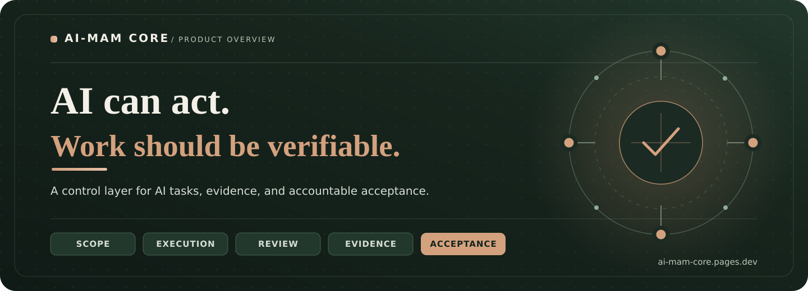

  

<h1 align="center">AI-MAM Core</h1>

  <strong>AI execution · Orchestration · Evidence-based acceptance</strong>

  <a href="https://ai-mam-core.pages.dev/">Explore the website</a>
  &nbsp;·&nbsp;
  <strong>V1 in controlled validation</strong>

---

## The missing layer in AI-assisted work

AI agents can generate code, work across files, and carry out increasingly complex tasks. But completing an action is not the same as proving that **the right task was completed, within the agreed scope, with a result that can be accepted**.

**AI-MAM Core** is a general-purpose AI task execution, orchestration, and governance core being developed to make that distinction operational. Its purpose is to connect the user's goal, execution boundaries, task continuity, independent review, evidence, and authorized acceptance in a coherent workflow.

## What AI-MAM Core is designed to do

| Challenge | AI-MAM Core's approach |
| :--- | :--- |
| **Scope drift** | Keep goals, exclusions, and acceptance criteria tied to the task. |
| **Lost continuity** | Preserve task state and the record of what happened across steps and interruptions. |
| **Uncontrolled execution** | Define meaningful execution boundaries, stopping conditions, and recovery paths. |
| **Unverified completion** | Assess actual outcomes against evidence and measurable conditions, separately from the producing agent's claim. |
| **Unclear acceptance** | Keep the final decision under explicit, owner-configured authority. |

### One task. A traceable path to acceptance.

**Define scope** → **Coordinate work** → **Execute within bounds** → **Verify evidence** → **Record acceptance**

Imagine a developer asking an AI agent to add CSV export to an existing application. AI-MAM's goal is not simply to obtain a new file. It is to account for the authorized changes, existing behavior, relevant tests, evidence, and the decision to accept or reject the result.

## Built for a practical starting point

Our initial focus is **software teams using AI coding agents**. The core is intended to be domain-agnostic: a control layer for AI tasks, not another code editor or an operating-system security product.

**Current stage:** The V1 core is in controlled validation. Selected behaviors have scoped local test evidence; integrated acceptance, packaging, and controlled-pilot readiness remain active engineering milestones.

## Founder & collaboration

**Kenan Ergin — Founder & Product Architect**

AI-MAM Core brings together experience in enterprise operations, risk, and product direction with AI-assisted development. We are exploring **engineering collaboration, grant and investment opportunities, and future controlled pilots**.

  <a href="https://ai-mam-core.pages.dev/"><strong>Discover AI-MAM Core →</strong></a>

## Get in Touch

Interested in AI-MAM Core?

We welcome conversations about:
- Investment and startup acceleration
- Strategic partnerships
- Engineering collaboration
- Early pilot opportunities

**Email:** [Contact AI-MAM Core](mailto:EMAIL_ADDRESS)

**Website:** https://ai-mam-core.pages.dev/

**Founder:** Kenan Ergin
---

This is a public product overview. The implementation and development history are privately maintained; this repository is not an open-source software release.
